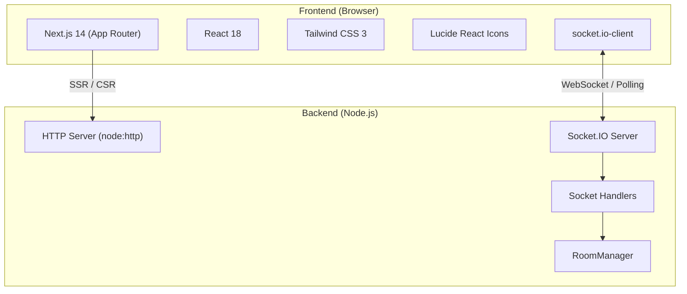
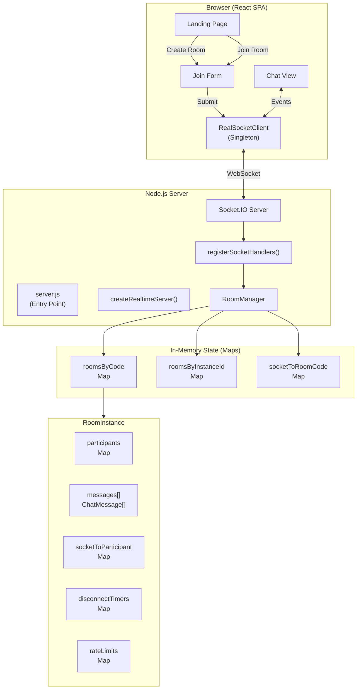
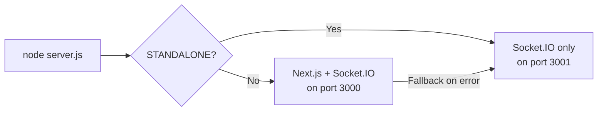
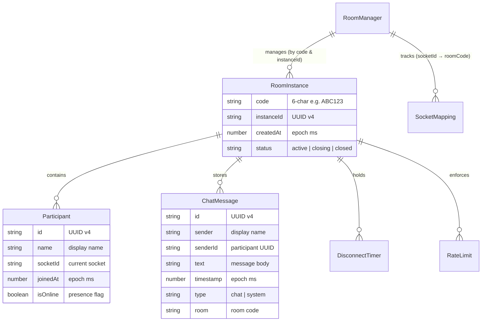
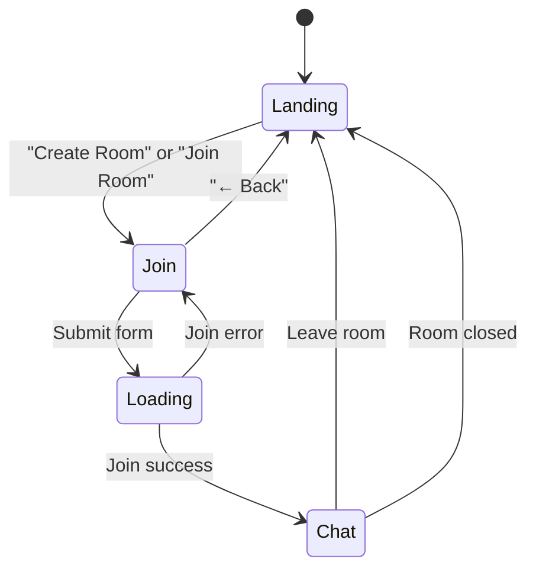
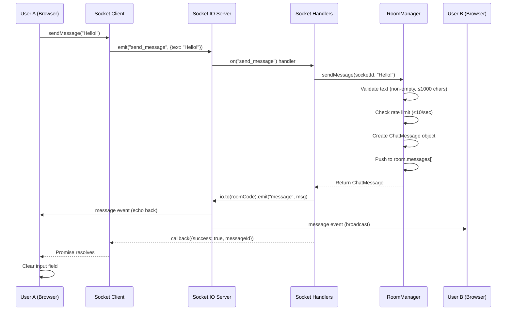
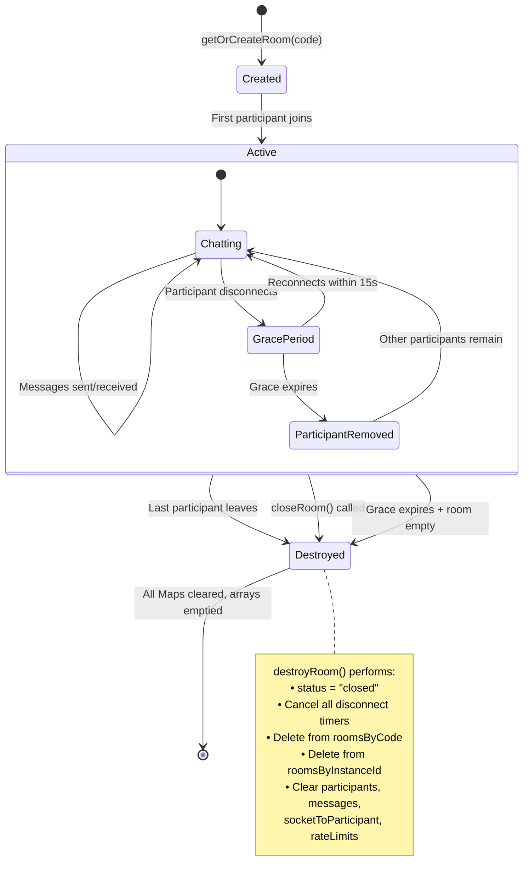
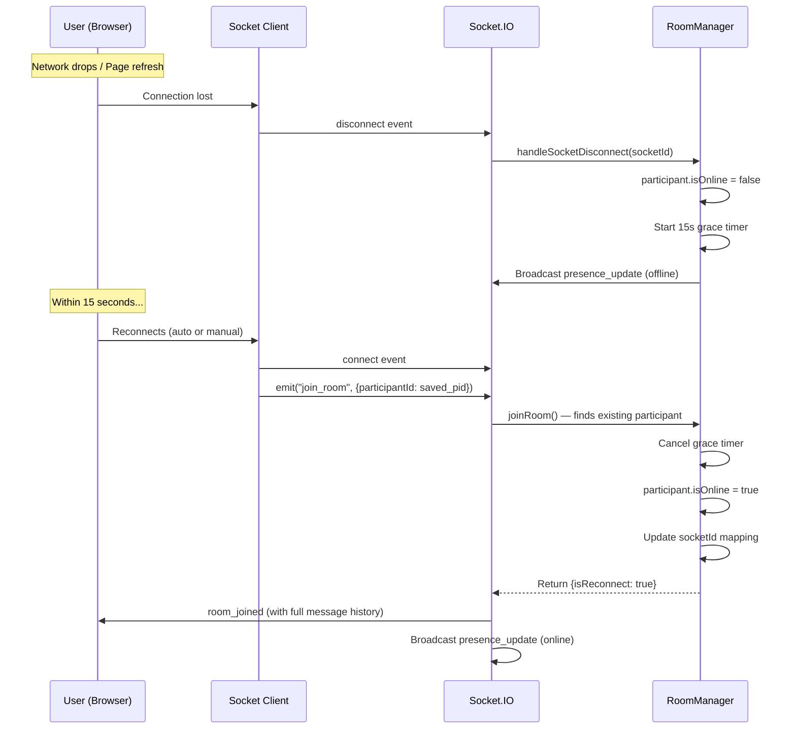
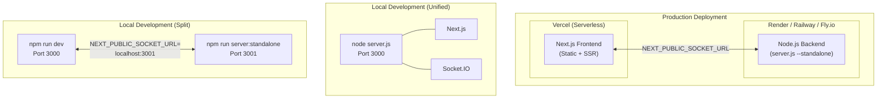

# ChitChat — Architecture & Working Document

> **Private, Real-Time, Ephemeral Messenger**
> Built with Next.js 14 · Socket.IO · Node.js · Tailwind CSS

---

## 1. System Overview

ChitChat is a **real-time, ephemeral chat application** where conversations exist exclusively in server memory. There is **no database** — all messages, participants, and room state are destroyed the moment the last user leaves or the room is explicitly closed.

### Core Design Principles

| Principle | Implementation |
|:---|:---|
| **Ephemeral by Default** | All data lives in-memory (`Map` objects); zero disk persistence |
| **Server-Authoritative** | All validation (room codes, names, message length, rate limits) enforced server-side |
| **Reconnection-Resilient** | 15-second grace period preserves session on network interruptions/page refresh |
| **Instance-Isolated** | Reusing a room code after destruction creates a completely fresh room (unique `instanceId`) |
| **Zero-Config Local Dev** | Unified mode runs frontend + backend on a single port |

---

## 2. Technology Stack



| Layer | Technology | Version |
|:---|:---|:---|
| Framework | Next.js (App Router, Turbopack dev) | ^14.2.4 |
| UI | React + Lucide React | ^18.3.1 / ^0.378.0 |
| Styling | Tailwind CSS + `clsx` + `tailwind-merge` | ^3.4.1 |
| Realtime | Socket.IO (server + client) | ^4.8.4 |
| Runtime | Node.js | v18+ |
| Language | TypeScript (frontend) / JavaScript (backend) | ^5 |

---

## 3. Project File Structure

```
chitchat/
├── server.js                    # Entry point — boots unified or standalone server
├── server/
│   ├── index.js                 # createRealtimeServer() factory
│   ├── room-manager.js          # RoomManager class — all room/participant state
│   └── socket-handlers.js       # registerSocketHandlers() — event routing
├── app/
│   ├── layout.tsx               # Root layout (Inter font, dark mode, metadata)
│   ├── page.tsx                 # Single-page app (Landing → Join → Chat views)
│   └── globals.css              # CSS variables, glassmorphism, custom scrollbar
├── lib/
│   ├── socket.ts                # RealSocketClient singleton (socket.io-client wrapper)
│   ├── socket-mock.ts           # Mock for testing/SSR
│   └── utils.ts                 # cn(), formatDate(), generateRoomCode()
├── types/
│   └── chat.ts                  # Shared TypeScript interfaces & union types
├── test/
│   ├── realtime-integration.test.js   # End-to-end Socket.IO integration tests
│   └── room-manager.test.js           # Unit tests for RoomManager
├── public/                      # Static assets
├── .env.example                 # Environment variable documentation
├── next.config.js               # Next.js configuration
├── tailwind.config.ts           # Tailwind theme extensions
├── tsconfig.json                # TypeScript configuration
└── package.json                 # Scripts, dependencies
```

---

## 4. Architecture Diagram



---

## 5. Server Architecture (Deep Dive)

### 5.1 Entry Point — `server.js`

The entry point supports **two runtime modes**:

| Mode | When | Behavior |
|:---|:---|:---|
| **Unified** (default) | `STANDALONE ≠ "true"` | Boots Next.js SSR + Socket.IO on a single HTTP server (port 3000) |
| **Standalone** | `STANDALONE = "true"` or `--standalone` flag | Runs Socket.IO backend only (port 3001), Next.js served separately |



**Unified mode** also exposes:
- `GET /health` — JSON health check with uptime
- `GET /api/rooms/:code` — Diagnostic room inspection (never exposes message content)

### 5.2 Server Factory — `server/index.js`

`createRealtimeServer(options)` returns an object with:

```javascript
{
  httpServer,    // node:http server
  io,            // Socket.IO Server instance
  roomManager,   // RoomManager instance
  listen(port, hostname),  // → Promise<actualPort>
  close()        // → Promise<void> (graceful shutdown)
}
```

**Socket.IO Configuration:**
- Transports: `["websocket", "polling"]` (WebSocket primary, long-polling fallback)
- Ping timeout: 20s, Ping interval: 10s
- CORS: configurable via `CORS_ORIGIN` env var

### 5.3 Room Manager — `server/room-manager.js`

The `RoomManager` class is the **core state engine**. It owns all in-memory data and enforces every business rule.

#### Data Model



#### Key Methods

| Method | Purpose |
|:---|:---|
| `normalizeRoomCode(code)` | Validates `^[A-Z0-9]{6}$`, uppercases, trims |
| `normalizeDisplayName(name)` | Validates non-empty, ≤ 30 chars |
| `getOrCreateRoom(code)` | Returns existing active room or creates fresh instance |
| `joinRoom(code, name, socketId, pid?)` | Joins or reconnects participant; cancels disconnect timer on reconnect |
| `sendMessage(socketId, text, clientMsgId?)` | Validates, rate-limits, stores message in room array |
| `handleSocketDisconnect(socketId, cb)` | Sets participant offline, starts 15s grace timer |
| `leaveRoom(socketId)` | Immediate removal; destroys room if last participant |
| `destroyRoom(instanceId)` | **Complete ephemeral purge** — clears all data, removes all references |

#### Validation Rules (Server-Enforced)

| Rule | Constraint |
|:---|:---|
| Room code format | `^[A-Z0-9]{6}$` |
| Display name length | 1–30 characters |
| Message length | 1–1,000 characters |
| Rate limit | 10 messages per 1,000ms window per participant |
| Disconnect grace | 15,000ms before participant removal |

### 5.4 Socket Event Handlers — `server/socket-handlers.js`

`registerSocketHandlers(io, roomManager)` maps Socket.IO events to `RoomManager` operations:

#### Event Flow Table

| Client Event | Server Handler | Server Emits | Recipients |
|:---|:---|:---|:---|
| `join_room` | `roomManager.joinRoom()` | `room_joined` (ack) + `user_joined` / `presence_update` + system `message` | Sender (ack) + Room peers |
| `send_message` | `roomManager.sendMessage()` | `message` | All room members |
| `leave_room` | `roomManager.leaveRoom()` | `user_left` + system `message` | Room peers |
| `close_room` | `roomManager.destroyRoom()` | `room_closed` | All room members |
| `disconnect` | `roomManager.handleSocketDisconnect()` | `user_left` + system `message` (after 15s grace) | Room peers |

---

## 6. Frontend Architecture (Deep Dive)

### 6.1 Application Structure

The frontend is a **single-page application** within Next.js App Router, using a single `page.tsx` component that manages three view states:



#### View States

| State | Description | Key UI |
|:---|:---|:---|
| **`landing`** | Home screen with branding | "Create a Room" + "Join a Room" cards |
| **`join`** | Credential entry form | Display name + Room code inputs |
| **`chat`** | Active chat interface | Sidebar (participants) + Message area + Input bar |

### 6.2 Socket Client — `lib/socket.ts`

`RealSocketClient` is a **singleton** class exported as `socket`. It wraps `socket.io-client` with:

- **Auto-reconnection**: Up to 10 attempts with 1–5s exponential backoff
- **Session persistence**: `participantId` stored in `sessionStorage` (`chitchat_pid`)
- **Transparent re-join**: On reconnect, automatically re-emits `join_room` with saved `participantId`
- **Observer pattern**: `on(listener)` returns an unsubscribe function

#### Client API

| Method | Returns | Purpose |
|:---|:---|:---|
| `join(room, user)` | `Promise<RoomJoinedResponse>` | Connect + join room (8s timeout) |
| `leave()` | `Promise<void>` | Explicit leave + cleanup |
| `sendMessage(text)` | `Promise<{success, messageId?, error?}>` | Send with 5s delivery timeout |
| `closeRoom()` | `Promise<void>` | Host closes the entire room |
| `on(listener)` | `() => void` (unsubscribe) | Register event listener |
| `getUser() / getRoom() / getParticipantId()` | `string \| null` | State getters |

#### Event Types Dispatched to Listeners

| Event Type | Data | Trigger |
|:---|:---|:---|
| `MESSAGE` | `{ room, message: ChatMessage }` | New chat or system message |
| `ROSTER` | `{ room, users: RoomParticipant[] }` | Full participant list update |
| `JOIN` | `{ room, user, participant? }` | Someone joined |
| `LEAVE` | `{ room, user, participantId? }` | Someone left |
| `PRESENCE` | `{ room, user, participant? }` | Reconnection presence update |
| `ROOM_CLOSED` | `{ room, reason }` | Room was closed by host |
| `ERROR` | `{ room?, error }` | Server error |

### 6.3 TypeScript Types — `types/chat.ts`

Shared type definitions used by both frontend and referenced by backend via JSDoc:

- `ChatMessage` — Message payload (id, sender, text, timestamp, type, room)
- `RoomParticipant` — Participant metadata
- `SocketEvent` — Discriminated union of all client-side events

### 6.4 UI Design System

Defined in `globals.css` with HSL CSS variables:

| Token | HSL Value | Usage |
|:---|:---|:---|
| `--background` | `224 71% 4%` | Deep navy page background |
| `--foreground` | `213 31% 91%` | Light text |
| `--primary` | `263.4 70% 50.4%` | Vibrant purple (buttons, accents, sent messages) |
| `--secondary` | `222.2 47.4% 11.2%` | Dark card backgrounds |
| `--accent` | `217.2 32.6% 17.5%` | Input fields, received messages |

Custom classes: `.glass` (glassmorphism panels), `.glass-card` (sidebar), custom scrollbar styling.

---

## 7. Complete Message Lifecycle



---

## 8. Room Lifecycle



### Instance Isolation Guarantee

When room `ABC123` is destroyed and a new user later joins `ABC123`:
1. `getOrCreateRoom("ABC123")` finds no active room (old was deleted)
2. Creates a **brand new `RoomInstance`** with a fresh `instanceId` (UUID)
3. Old messages, participants, and state are **permanently gone** — no bleed-through

---

## 9. Reconnection Flow



**Key Detail:** The `participantId` is persisted in `sessionStorage` (key: `chitchat_pid`), surviving page refreshes but not tab closes. Room/name info is stored in `chitchat_auth`.

---

## 10. Deployment Topology



### Environment Variables

| Variable | Purpose | Default |
|:---|:---|:---|
| `NEXT_PUBLIC_SOCKET_URL` | Socket.IO backend URL for the frontend | `window.location.origin` |
| `PORT` | Server listen port | `3000` (unified) / `3001` (standalone) |
| `HOST` | Bind address | `0.0.0.0` |
| `CORS_ORIGIN` | Allowed origins for Socket.IO | `*` |
| `STANDALONE` | Enable standalone mode | `false` |

---

## 11. Testing Strategy

Tests use Node.js built-in test runner (`node --test`):

| Test File | Coverage |
|:---|:---|
| `test/room-manager.test.js` | Unit tests for `RoomManager` — join, leave, destroy, validation |
| `test/realtime-integration.test.js` | Full E2E tests with real Socket.IO connections — bidirectional messaging, 200+ message conversations, concurrent load, cross-room isolation, reconnection, memory purge, room code reuse |

---

## 12. Security Model

| Layer | Mechanism |
|:---|:---|
| **Transport** | WebSocket over TLS (in production) |
| **Input Validation** | Server-side regex, length bounds, type checks |
| **Rate Limiting** | 10 msgs/sec per participant (sliding window) |
| **No Persistence** | Messages never touch disk or database |
| **Room Isolation** | Each room is a separate Map; no cross-room data leaks |
| **Instance UUIDs** | `crypto.randomUUID()` prevents room code reuse collisions |

> **IMPORTANT:** ChitChat guarantees **application-level deletion** only. Transport-layer buffers, ISP logs, browser caches, and OS memory snapshots are outside application control.

---

## 13. NPM Scripts Reference

| Script | Command | Purpose |
|:---|:---|:---|
| `npm start` | `node server.js` | Production unified server |
| `npm run dev` | `next dev --turbo` | Frontend dev with Turbopack |
| `npm run server` | `node server.js` | Alias for unified server |
| `npm run server:standalone` | `node server.js --standalone` | Backend only (port 3001) |
| `npm run build` | `next build` | Production build |
| `npm test` | `node --test test/**/*.test.js` | Run test suite |
| `npm run lint` | `next lint` | ESLint |
