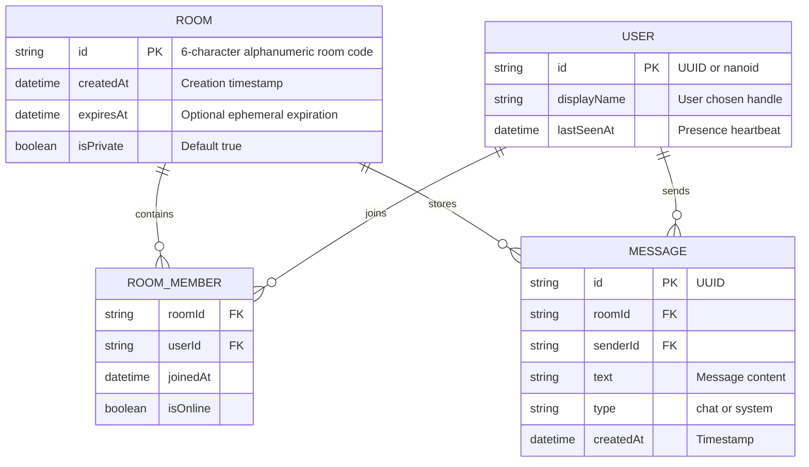

# ChitChat | API & Database Documentation

## 1. API Architecture & Endpoint Analysis

### HTTP / REST / GraphQL Endpoints
- **Verified Status**: **Zero HTTP Endpoints**.
- **Evidence**:
  - Scanning `app/api/` or `pages/api/` reveals no route handlers or server functions.
  - Next.js Server Actions are not implemented.
  - All communication is performed client-side using `BroadcastChannel`.

---

### Internal Event-Driven Messaging Protocol (`lib/socket-mock.ts`)

Instead of standard HTTP requests, the application communicates through an in-memory, event-driven message protocol managed by `SocketMock`.

#### Channel Specification
- **Channel Identifier**: `"chitchat_rooms"`
- **Transport**: Native W3C `BroadcastChannel` Web API
- **Origin Constraint**: Same-origin only (`window.location.origin`)

#### Event Protocol Schema (`SocketEvent`)

| Event Type | Direction | Payload Structure | Trigger & Purpose |
| :--- | :--- | :--- | :--- |
| `JOIN` | Outgoing broadcast | `{ type: "JOIN", room: string, user: string }` | Emitted when a client joins a room. Prompts peers to record the new user and reply with `PRESENCE`. |
| `PRESENCE`| Outgoing broadcast | `{ type: "PRESENCE", room: string, user: string }`| Emitted by existing occupants upon hearing a `JOIN` event to announce their presence to the newcomer. |
| `MESSAGE` | Outgoing & Local | `{ type: "MESSAGE", room: string, message: ChatMessage }` | Emitted when a user submits text. Broadcasts to peers and dispatches to local listeners. |
| `LEAVE` | Outgoing & Local | `{ type: "LEAVE", room: string, user: string }` | Emitted when a user clicks the "Leave Room" button. Instructs peers to remove the user from their roster. |

#### Message Payload Interface (`ChatMessage`)
```typescript
export interface ChatMessage {
  id: string;        // Random base36 identifier (e.g., "7f9k2la1m")
  sender: string;    // User display name (e.g., "Alex") or "System"
  text: string;      // The raw chat text content
  timestamp: number; // Unix epoch milliseconds (Date.now())
  type: "chat" | "system"; // Message categorization
}
```

---

## 2. Database & Data Persistence Analysis

### Database Infrastructure
- **Verified Status**: **Zero Database Engines**.
- **Evidence**:
  - No ORM, query builder, or database client exists in `package.json` (no Prisma, Drizzle, Mongoose, TypeORM, Supabase, or SQLite).
  - No database migration files or connection strings exist.

---

### Storage Mechanisms in Use

| Storage Layer | Storage Mechanism | Lifetime | Scope | What is Stored |
| :--- | :--- | :--- | :--- | :--- |
| **Active Chat Feed** | Volatile React State (`useState<ChatMessage[]>`) | Lost on page refresh or navigation | Single browser tab | Array of messages received during current session |
| **Online Users** | Volatile React State (`useState<string[]>`) | Lost on page refresh or navigation | Single browser tab | List of usernames active in current room |
| **Session Auth** | Browser `sessionStorage` (`"chitchat_auth"`) | Preserved across reloads; destroyed when tab closes | Single browser tab | `{ name: string, room: string }` |

---

### Concurrency, Volatility & Data Integrity Risks

1. **Complete History Amnesia**:
   - Because message history is stored only in React memory, new users joining an existing room receive **0 previous messages**.
   - If an existing user hits browser Refresh (F5), their chat history is permanently wiped.
2. **Ghost Presence on Passive Unload**:
   - If a participant closes the browser tab directly without clicking "Leave Room", no `LEAVE` event is fired.
   - The user remains in the online user list of all other tabs indefinitely until those tabs are refreshed.
3. **Cross-Room Message Crosstalk Risk**:
   - All rooms share the single `"chitchat_rooms"` channel name.
   - Any script running on the origin can observe all messages across all rooms, representing a data isolation vulnerability.
4. **Display Name Hijacking & Collisions**:
   - There are no user IDs or authentication credentials. Two tabs can enter the same room with the name "Alice", causing message sender confusion and array deduplication artifacts.

---

## 3. Recommended Future Backend Schema Blueprint

If the project is migrated from the `BroadcastChannel` mock to a persistent full-stack architecture (e.g. Next.js Route Handlers + Prisma + PostgreSQL/SQLite), the following data model should be implemented:


