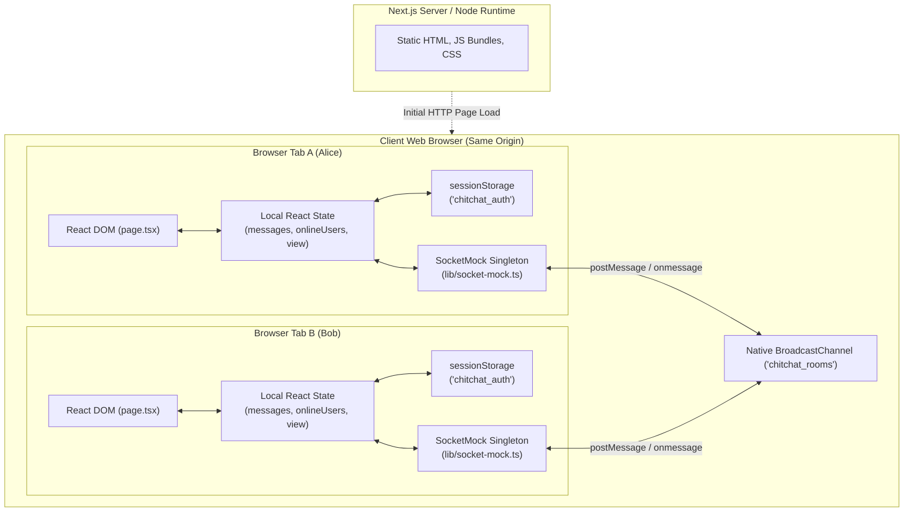
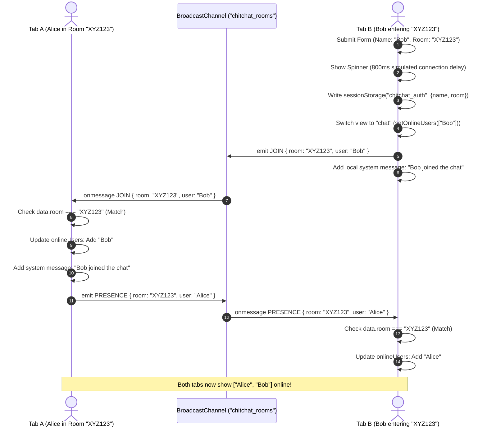
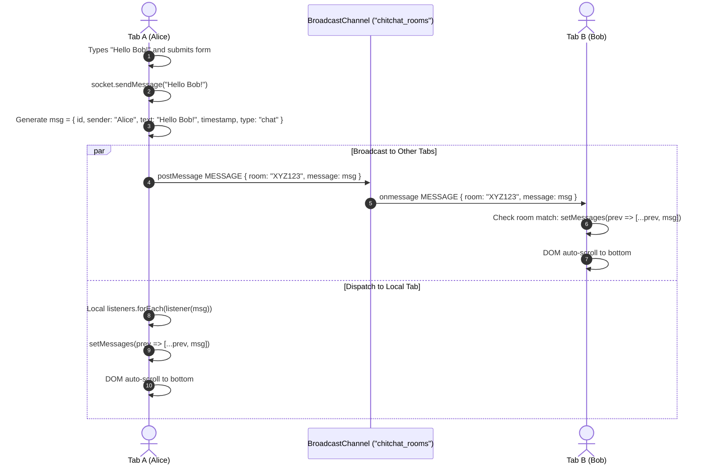

# ChitChat | System Architecture & Data Flow

## 1. High-Level System Architecture

ChitChat operates as an entirely client-driven Single Page Application running within the Next.js 14 App Router runtime. Although served from a Next.js web application structure, all communication and state mutations occur exclusively in the browser runtime.



---

## 2. Component Hierarchy & State Model

The entire visual application resides in a single component `Home` in `app/page.tsx`. Its internal state machine directs the rendering pipeline:

```mermaid
stateDiagram-v2
    [*] --> CheckSession: Mount (useEffect)
    CheckSession --> LandingView: No sessionStorage
    CheckSession --> LoadingState: sessionStorage exists ("chitchat_auth")
    
    state LandingView {
        [*] --> SelectAction
        SelectAction --> GenerateCode: Click "Create a Room"
        SelectAction --> JoinView: Click "Join a Room"
    }

    GenerateCode --> JoinView: Prefills 6-digit room code
    
    state JoinView {
        [*] --> FormInput: Enter Display Name & Room Code
        FormInput --> ValidateInput: Click "Enter Chat Room"
        ValidateInput --> FormInput: Validation Error (empty / <6 chars)
        ValidateInput --> LoadingState: Valid Input
    }

    state LoadingState {
        [*] --> TimerWait: 800ms simulated connection delay
        TimerWait --> ChatView: Set view = "chat"
    }

    state ChatView {
        [*] --> ConnectSocket: socket.join(room, name)
        ConnectSocket --> ActiveChat: Listen for events & render UI
        ActiveChat --> LandingView: Click "Leave Room" (socket.leave())
    }
```

---

## 3. Real-Time Communication Engine (`SocketMock`)

### The `BroadcastChannel` Mechanism
1. **Scope & Origin**:
   - `BroadcastChannel` allows communication between different browsing contexts (tabs, windows, iframes, workers) sharing the **exact same origin** (`protocol + hostname + port`).
   - Cross-browser (e.g., Chrome to Firefox) or cross-device (e.g., PC to mobile) communication is impossible without a centralized network server.
2. **Channel Singleton**:
   - The constructor of `SocketMock` opens a channel named `"chitchat_rooms"`:
     ```ts
     this.channel = new BroadcastChannel("chitchat_rooms");
     ```
   - All rooms share this single channel. Room multiplexing is achieved via an envelope property (`data.room`).
3. **Loopback Behavior**:
   - The W3C specification dictates that `BroadcastChannel.postMessage()` sends events to **all other** listening contexts, but **does not dispatch to the sender**.
   - Because of this, `sendMessage` explicitly calls local listeners:
     ```ts
     this.emit({ type: "MESSAGE", room: this.room, message });
     this.listeners.forEach(listener => listener({ type: "MESSAGE", room: this.room!, message }));
     ```
   - For `JOIN`, the local tab intentionally does not trigger its own listener, instead generating its own local system message in `app/page.tsx:120`.

---

## 4. Sequence & Event Flow

### Room Joining & Presence Handshake Sequence

When a user in Tab B joins a room already occupied by a user in Tab A:



---

### Message Dispatch Sequence



---

## 5. Architectural Tradeoffs & Verified Limitations

| Architectural Decision | Chosen Implementation | Tradeoff / Consequence | Code Evidence |
| :--- | :--- | :--- | :--- |
| **Real-time Engine** | Native `BroadcastChannel` | Zero backend setup required, but strictly limited to same-browser, same-origin tabs. Cannot support mobile/desktop interop. | `lib/socket-mock.ts:27` |
| **Data Persistence** | None (in-memory arrays) | Messages are lost upon page reload or tab closure. New joiners cannot see message history. | `app/page.tsx:30` |
| **Session Tracking** | Browser `sessionStorage` | Preserves name & room across refresh, but clears when closing tab. Refresh causes complete message history loss. | `app/page.tsx:42, 109` |
| **Presence Teardown** | Manual button click only | Closing a tab directly fails to emit `LEAVE`. Ghost users remain permanently in other tabs' rosters. | `app/page.tsx:170`, `lib/socket-mock.ts:47` |
| **Component Structure** | Monolithic `page.tsx` | All 3 screens and sidebar reside in one file. Hinders component reusability and isolated unit testing. | `app/page.tsx` (449 lines) |
| **Theme System** | HSL CSS variables | Intended for dynamic theme toggling, but missing `hsl()` wrapper in `tailwind.config.ts`, breaking classes. | `tailwind.config.ts:12-33`, `app/globals.css:5-26` |
